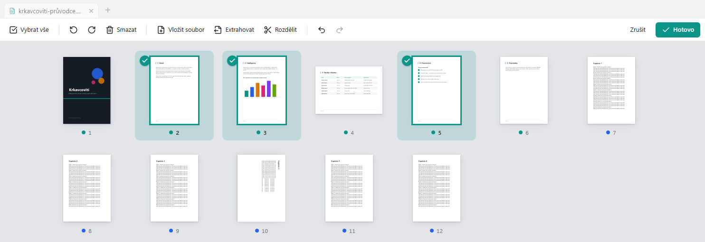

# Scamcrobat

[English](README.md) · **Čeština**

Svobodný (AGPL-3.0) prohlížeč a editor PDF – komentáře, formuláře, podpisy, opravy textu,
začernění, ochrana heslem a úpravy stránek bez předplatného, bez účtu a bez reklam.
Běží jako desktopová aplikace pro Windows (lze nastavit jako výchozí program pro `.pdf`)
i jako webová stránka; obě verze sdílí stejný kód.

**[⬇ Stáhnout pro Windows](https://github.com/Aleshek/Scamcrobat/releases/latest)** ·
**[Vyzkoušet v prohlížeči](https://aleshek.github.io/Scamcrobat/)**

<picture>
  <source media="(prefers-color-scheme: dark)" srcset="docs/cs/viewer-dark.png">
  
</picture>

<picture>
  <source media="(prefers-color-scheme: dark)" srcset="docs/cs/organizer-dark.png">
  
</picture>

## Stažení

**Windows:** instalátor `Scamcrobat-Setup-….exe` je u [poslední verze](https://github.com/Aleshek/Scamcrobat/releases/latest).
Instaluje se jen pro aktuálního uživatele (nepotřebuje práva správce) a zaregistruje se
jako program pro `.pdf`. Windows 11 nedovolí aplikacím nastavit se jako výchozí samy, takže
po instalaci: pravým tlačítkem na PDF → Otevřít v programu → Zvolit jinou aplikaci →
Scamcrobat → Vždy.

Instalátor zatím není digitálně podepsaný, proto Windows SmartScreen při prvním spuštění
zobrazí varování („Další informace → Přesto spustit“).

**Web:** stejná aplikace běží i v prohlížeči na <https://aleshek.github.io/Scamcrobat/>.
Soubory se nikam neodesílají – vše se zpracovává přímo ve vašem prohlížeči.

Aplikace je **česky** i **anglicky**; řídí se jazykem systému a přepnout jde na úvodní obrazovce.

## Co umí (verze 0.5)

- otevření PDF dvojklikem, z dialogu (Ctrl+O) nebo přetažením do okna
- **karty** pro více otevřených dokumentů (Ctrl+Tab přepnutí, Ctrl+W zavření, Ctrl+T nová karta);
  další PDF otevřené z Průzkumníka přibude jako karta do běžícího okna
- plynulé zobrazení všech stránek, náhledy stránek a záložky (osnova dokumentu)
- zoom tlačítky, Ctrl+kolečkem (kolem kurzoru), „na šířku“ (Ctrl+2), „celá stránka“ (Ctrl+0), 100 % (Ctrl+1)
- hledání v textu (Ctrl+F, Enter/F3 další výsledek, Shift+F3 předchozí) – nezáleží na velikosti písmen ani diakritice
- výběr textu myší (dvojklik vybere slovo) a kopírování (Ctrl+C)
- **komentáře** (tlačítko „Komentáře“): zvýraznění, podtržení a přeškrtnutí textu (stačí text
  označit se zapnutým nástrojem, nebo vybrat nástroj pro už označený text), poznámky, textová pole
  a kreslení od ruky v několika barvách; kliknutím na komentář ho lze přesunout, zvětšit,
  přebarvit nebo smazat; Zpět/Znovu (Ctrl+Z / Ctrl+Y). Komentáře jsou běžné anotace PDF, takže je
  uvidí i jiné prohlížeče
- **vyplňování formulářů PDF** – textová pole, zaškrtávátka a rozbalovací seznamy přímo na stránce
- **podpis** (tlačítko „Podepsat“): podpis se nakreslí myší, perem nebo prstem, nebo se načte jeho
  fotka (papírové pozadí se odstraní), a pak stačí kliknout, kam patří, případně do pole pro podpis;
  na tomto zařízení si lze zapamatovat až čtyři podpisy
- **oprava textu** (tlačítko „Upravit“): stačí kliknout na řádek a opravit překlep, datum, jméno
  nebo částku; řádek se napíše znovu na stejné místo stejným písmem, velikostí i barvou. Písmena,
  která ve vloženém písmu chybí, se doplní vestavěným písmem se stejnými šířkami (Helvetica/Arial,
  Times, Courier – bezpatkové, patkové i neproporcionální, tučné i kurzíva podle originálu); Zpět/Znovu
- **začernění** („Upravit“ → Začernit text / Začernit oblast): vše pod černým pruhem – text, pixely
  obrázků, kresby, odkazy, komentáře i formulářová pole – se ze souboru opravdu odstraní, ne jen
  zakryje. Do uložení jde začernění vrátit; před uložením se aplikace zeptá, protože pak už obsah
  zmizí natrvalo
- **ochrana heslem** (tlačítko se zámkem): heslo k otevření dokumentu, omezení tisku, kopírování
  a změn chráněné heslem oprávnění, nebo obojí – šifrování AES 256 bitů při uložení; chráněný
  dokument lze s heslem oprávnění změnit nebo ochranu odstranit
- **klikací odkazy** – na jiné stránky dokumentu i na webové stránky
- **nedávné soubory** na úvodní obrazovce (desktop); dokument se znovu otevře na stránce, kde jste skončili
- **tisk** (Ctrl+P) – všechny stránky, aktuální nebo rozsah; stránky na šířku zůstanou na šířku
- **export stránek do JPG / PNG / WebP** (Ctrl+E) – volba DPI, kvality, rozsahu stránek
  a názvů souborů bez diakritiky pro web
- **uspořádání stránek** (tlačítko „Uspořádat stránky“): otáčení, mazání, přeskládání
  přetažením, vložení stránek z jiného PDF (i přetažením souboru přímo mezi stránky),
  Zpět/Znovu (Ctrl+Z / Ctrl+Y)
- **sloučení více PDF do jednoho** (na úvodní obrazovce nebo „Vložit PDF“)
- **rozdělení PDF** po stránkách, po N stránkách nebo podle rozsahů a **extrakce** vybraných stránek
- uložení (Ctrl+S) a Uložit jako (Ctrl+Shift+S); záložky, metadata a formuláře původního
  dokumentu zůstávají zachované, upozornění na neuložené změny při zavírání; komentáře a hodnoty
  formulářů se do souboru pokud možno připisují na konec, takže původní obsah zůstane netknutý;
  po začernění, opravě textu nebo změně ochrany se celý soubor zapíše znovu, aby v něm nic
  odstraněného nezůstalo
- otevírání dokumentů chráněných heslem
- světlý i tmavý vzhled podle nastavení systému

## Vývoj

Vývojová dokumentace (spuštění, sestavení, vydání nové verze, architektura, překlady
a automatické testy) je v [anglickém README](README.md#development).

## Plán

Hotovo: **0.1** prohlížeč a export do obrázků · **0.2** uspořádání stránek, slučování, rozdělení,
ukládání · **0.3** tisk, karty, angličtina · **0.4** komentáře, formuláře, podpisy, odkazy,
nedávné soubory · **0.5** začernění, oprava textu po řádcích, ochrana heslem a oprávnění

**Později**, zhruba v tomto pořadí:

| Funkce | Náročnost |
|---|---|
| Otáčení zobrazení, celá obrazovka, dvě stránky vedle sebe | malá |
| Sloučení záložek ze všech slučovaných PDF | malá |
| Ořez stránek, vodoznak, číslování stránek | malá – střední |
| Obrázky → PDF, komprese PDF | střední |
| Porovnání dvou verzí dokumentu | střední |
| OCR naskenovaných dokumentů | větší |
| Ověření elektronického podpisu, podepisování certifikátem | větší |
| Úprava celých odstavců s přeskládáním textu (jen pokud opravy po řádcích nebudou stačit) | velmi velká |

**Neplánujeme:** převod Word → PDF (Word to umí sám), převod PDF → Word, cloudové úložiště a sdílení.

## Licence

[GNU AGPL-3.0 nebo novější](LICENSE). MuPDF © Artifex Software, Inc., AGPL-3.0.

Scamcrobat je nezávislý projekt a nemá nic společného se společností Adobe.
Adobe a Acrobat jsou ochranné známky společnosti Adobe Inc.
