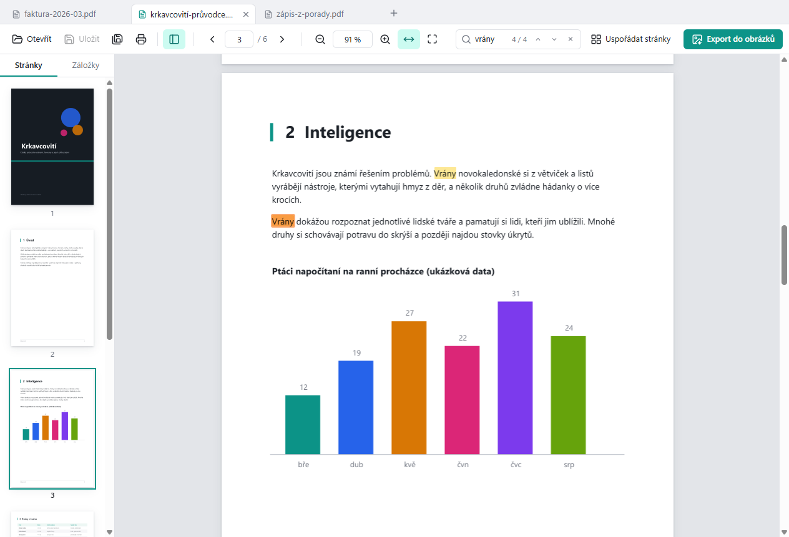

# Scamcrobat

[English](README.md) · **Čeština**

Svobodný (AGPL-3.0) prohlížeč a editor stránek PDF – bez předplatného, bez účtu, bez reklam.
Běží jako desktopová aplikace pro Windows (lze nastavit jako výchozí program pro `.pdf`)
i jako webová stránka; obě verze sdílí stejný kód.

**[⬇ Stáhnout pro Windows](https://github.com/Aleshek/Scamcrobat/releases/latest)** ·
**[Vyzkoušet v prohlížeči](https://aleshek.github.io/Scamcrobat/)**

<picture>
  <source media="(prefers-color-scheme: dark)" srcset="docs/cs/viewer-dark.png">
  
</picture>

<picture>
  <source media="(prefers-color-scheme: dark)" srcset="docs/cs/organizer-dark.png">
  
</picture>

## Stažení

**Windows:** instalátor `Scamcrobat-Setup-….exe` je u [poslední verze](https://github.com/Aleshek/Scamcrobat/releases/latest).
Instaluje se jen pro aktuálního uživatele (nepotřebuje práva správce) a zaregistruje se
jako program pro `.pdf`. Windows 11 nedovolí aplikacím nastavit se jako výchozí samy, takže
po instalaci: pravým tlačítkem na PDF → Otevřít v programu → Zvolit jinou aplikaci →
Scamcrobat → Vždy.

Instalátor zatím není digitálně podepsaný, proto Windows SmartScreen při prvním spuštění
zobrazí varování („Další informace → Přesto spustit“).

**Web:** stejná aplikace běží i v prohlížeči na <https://aleshek.github.io/Scamcrobat/>.
Soubory se nikam neodesílají – vše se zpracovává přímo ve vašem prohlížeči.

Aplikace je **česky** i **anglicky**; řídí se jazykem systému a přepnout jde na úvodní obrazovce.

## Co umí (verze 0.3)

- otevření PDF dvojklikem, z dialogu (Ctrl+O) nebo přetažením do okna
- **karty** pro více otevřených dokumentů (Ctrl+Tab přepnutí, Ctrl+W zavření, Ctrl+T nová karta);
  další PDF otevřené z Průzkumníka přibude jako karta do běžícího okna
- plynulé zobrazení všech stránek, náhledy stránek a záložky (osnova dokumentu)
- zoom tlačítky, Ctrl+kolečkem (kolem kurzoru), „na šířku“ (Ctrl+2), „celá stránka“ (Ctrl+0), 100 % (Ctrl+1)
- hledání v textu (Ctrl+F, Enter/F3 další výsledek, Shift+F3 předchozí) – nezáleží na velikosti písmen ani diakritice
- výběr textu myší (dvojklik vybere slovo) a kopírování (Ctrl+C)
- **tisk** (Ctrl+P) – všechny stránky, aktuální nebo rozsah; stránky na šířku zůstanou na šířku
- **export stránek do JPG / PNG / WebP** (Ctrl+E) – volba DPI, kvality, rozsahu stránek
  a názvů souborů bez diakritiky pro web
- **uspořádání stránek** (tlačítko „Uspořádat stránky“): otáčení, mazání, přeskládání
  přetažením, vložení stránek z jiného PDF (i přetažením souboru přímo mezi stránky),
  Zpět/Znovu (Ctrl+Z / Ctrl+Y)
- **sloučení více PDF do jednoho** (na úvodní obrazovce nebo „Vložit PDF“)
- **rozdělení PDF** po stránkách, po N stránkách nebo podle rozsahů a **extrakce** vybraných stránek
- uložení (Ctrl+S) a Uložit jako (Ctrl+Shift+S); záložky, metadata a formuláře původního
  dokumentu zůstávají zachované, upozornění na neuložené změny při zavírání
- dokumenty chráněné heslem
- světlý i tmavý vzhled podle nastavení systému

## Vývoj

Vývojová dokumentace (spuštění, sestavení, vydání nové verze, architektura, překlady
a automatické testy) je v [anglickém README](README.md#development).

## Plán

| Funkce | Náročnost |
|---|---|
| ~~Spojování, rozdělení, mazání a otáčení stránek + uložení PDF~~ | hotovo v 0.2 |
| ~~Tisk, karty pro více dokumentů, angličtina~~ | hotovo v 0.3 |
| Otáčení zobrazení, klikací odkazy | malá |
| Sloučení záložek ze všech slučovaných PDF | malá |
| Obrázky → PDF, komprese PDF | střední |
| Anotace (zvýraznění, poznámky) a vyplňování formulářů | větší |
| Vložení obrázku podpisu | střední |
| OCR naskenovaných dokumentů | větší |
| Úprava existujícího textu | velmi velká |

## Licence

[GNU AGPL-3.0 nebo novější](LICENSE). MuPDF © Artifex Software, Inc., AGPL-3.0.

Scamcrobat je nezávislý projekt a nemá nic společného se společností Adobe.
Adobe a Acrobat jsou ochranné známky společnosti Adobe Inc.
