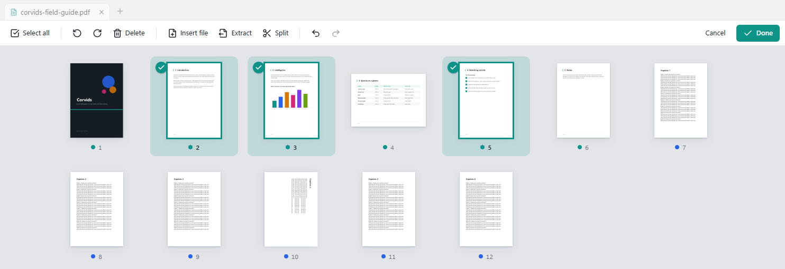

# Scamcrobat

**English** · [Čeština](README.cs.md)

[](https://github.com/Aleshek/Scamcrobat/actions/workflows/ci.yml)
[](https://github.com/Aleshek/Scamcrobat/releases/latest)

A free (AGPL-3.0) PDF viewer and editor – comments, forms, signatures, text corrections,
redaction, password protection, page editing, PDFs from images and smaller files with no
subscription, no account and no ads.
It runs as a Windows desktop app (it can be your default program for `.pdf` files)
and as a web page; both versions share the same code.

**[⬇ Download for Windows](https://github.com/Aleshek/Scamcrobat/releases/latest)** ·
**[Try it in your browser](https://aleshek.github.io/Scamcrobat/)**

<picture>
  <source media="(prefers-color-scheme: dark)" srcset="docs/viewer-dark.png">
  
</picture>

<picture>
  <source media="(prefers-color-scheme: dark)" srcset="docs/organizer-dark.png">
  
</picture>

## Download

**Windows:** the `Scamcrobat-Setup-….exe` installer is attached to the
[latest release](https://github.com/Aleshek/Scamcrobat/releases/latest).
It installs for the current user only (no administrator rights needed) and registers itself
as a program for `.pdf` files. Windows 11 does not let apps make themselves the default, so
after installing: right-click a PDF → Open with → Choose another app → Scamcrobat → Always.
For images (JPG, PNG, GIF, BMP, TIFF, WebP) Scamcrobat is only added to "Open with" – it makes
a PDF of them – and never becomes their default app.

The installer is not digitally signed yet, so Windows SmartScreen shows a warning the first
time it runs ("More info → Run anyway").

**Web:** the same app runs in the browser at <https://aleshek.github.io/Scamcrobat/>.
Your files are never uploaded – everything is processed right in your browser.

The app is available in **English** and **Czech**; it follows the system language and can be
switched on the start page.

## Features (version 0.7)

- open PDFs by double click, from the dialog (Ctrl+O) or by dropping them into the window
- **PDF from images**: JPG, PNG, GIF, BMP, TIFF (every page of it) and WebP images opened from the
  dialog, dropped into the window or sent with "Open with" from Explorer become a new PDF, one page
  per image – several at once make one PDF, in the order of their names ("Create PDF from images"
  on the start page). Scans keep their size; photos and screenshots are fitted on A4 (Letter in
  the US and Canada) with a 10 mm margin. JPEG photos go into the PDF as they are, with no loss
- **tabs** for several open documents (Ctrl+Tab to switch, Ctrl+W to close, Ctrl+T for a new tab);
  opening another PDF from Explorer adds a tab to the running window
- smooth scrolling through all pages, page thumbnails and bookmarks (document outline)
- zoom with buttons, Ctrl+wheel (around the cursor), fit width (Ctrl+2), fit page (Ctrl+0), 100 % (Ctrl+1)
- **view** (the View menu): rotate the view by 90° (Ctrl+Shift+Plus / Minus) without changing the
  file, **two pages side by side** – from the first page, or after a cover page like an open book
  (documents that ask for it open that way) – and **full screen** (Ctrl+L, F11 in the desktop app):
  one page or pair of pages at a time, turned with the arrows, the wheel, Page Down or Space; Esc ends it
- text search (Ctrl+F, Enter/F3 next result, Shift+F3 previous) – ignores case and accents
- text selection with the mouse (double click selects a word) and copying (Ctrl+C)
- **comments** ("Annotate"): highlight, underline and strike out text (select it with the tool
  on, or pick the tool for an already selected text), sticky notes, text boxes and freehand
  drawing in several colors; click a comment to move, resize, recolor or delete it; undo/redo
  (Ctrl+Z / Ctrl+Y). Comments are standard PDF annotations, so other PDF readers show them too
- **filling in PDF forms** – text fields, check boxes and drop-down lists right on the page
- **signing** ("Sign"): draw your signature with the mouse, pen or finger, or load a photo of it
  (the paper background is removed), then click where it belongs or into a signature field;
  up to four signatures can be remembered on this device
- **correcting text** ("Edit"): click a line of text and fix a typo, a date, a name or an amount;
  the line is written again in the same place with the same font, size and color. Letters the
  embedded font does not contain come from a built-in font with the same widths (Helvetica/Arial,
  Times, Courier – sans, serif or mono, bold and italic follow the original); undo/redo
- **redaction** ("Edit" → Black out text / Black out an area): whatever is under the black box –
  text, image pixels, drawings, links, comments and form fields – is really removed from the
  file, not just covered. Until you save it can be undone; saving asks first, because then it is gone for good
- **password protection** (the lock button): a password to open the document, restrictions of
  printing, copying and changes guarded by a permissions password, or both – AES 256-bit, applied
  when you save; a protected document can be changed or unprotected with its permissions password
- **respecting restrictions** of secured documents, the way Adobe Acrobat does: when the author
  does not allow printing, copying (also exporting to images and taking pages into another PDF),
  editing, comments, filling in forms or organizing pages, those tools are turned off and a bar
  says why; "Unlock…" lifts the restrictions with the permissions password until you close the document
- **clickable links** – to other pages of the document and to web pages
- **recent files** on the start page (desktop); a document reopens on the page where you left it
- **printing** (Ctrl+P) – all pages, the current one or a range; landscape pages stay landscape
- **export pages to JPG / PNG / WebP** (Ctrl+E) – DPI, quality, page range and web friendly file names
- **organizing pages** ("Organize pages"): rotate, delete, reorder by dragging, insert pages
  from another PDF or images (also by dropping a file right between the pages), undo/redo (Ctrl+Z / Ctrl+Y)
- **merging several PDFs into one** (on the start page or with "Insert file"), images included; the
  bookmarks of every merged file are kept, each file's under a bookmark named after it
- **reducing file size** (the button next to the lock): a smaller copy of the document – images
  drawn at a higher resolution than needed are scaled down to 100, 150 or 300 ppi and stored as
  JPEG (or kept as they are), unused and duplicate objects, private data of other programs and
  embedded thumbnails are removed, fonts keep only the characters used and everything is
  compressed. The dialog shows the size before and after, then saves the copy or opens it in a new
  tab; the document itself stays as it is. A secured document stays secured with the same
  passwords, and it needs the permission to make changes
- **cropping pages** ("Edit" → Crop pages): drag a box around what should stay, fine-tune the margins
  in millimeters and apply it to this page, all pages or a range; only the visible area changes,
  the content outside stays in the file
- **watermark** ("Edit" → Watermark): text, size, color, opacity, rotation, over or behind the
  page content, with a preview
- **page numbers** ("Edit" → Page numbers): six positions, formats "1", "1 / 10", "Page 1 of 10"
  or "– 1 –", any first number, all pages or a range
- **splitting a PDF** into single pages, chunks of N pages or ranges, and **extracting** selected pages
- Save (Ctrl+S) and Save as (Ctrl+Shift+S); bookmarks, metadata and forms of the original
  document are kept, and you are warned about unsaved changes when closing; comments and form
  values are appended to the end of the file whenever possible, so the original content stays intact;
  after a redaction, a text correction or a change of the protection the whole file is written
  again, so nothing removed stays inside
- opening password protected documents
- light and dark theme following the system setting

## Development

You need [Node.js](https://nodejs.org/) 22+.

```bash
npm install
npm run dev          # web version at http://localhost:5173
npm run dev:app      # desktop version (Electron) with live reload
npm run app          # desktop version from a production build
```

If Electron was not downloaded during `npm install` (npm 12 blocks install scripts),
run `node node_modules/electron/install.js` once.

## Building

```bash
npm run build        # web version into dist/ (upload it to any static hosting)
npm run dist         # Windows installer into release/
```

### Releasing a new version

Installers are built by GitHub (`.github/workflows/release.yml`), not on a developer's machine:

1. bump `version` in `package.json` (and run `npm install --package-lock-only`), commit
2. `git tag -a v0.3.0 -m "Scamcrobat 0.3.0"` and `git push origin v0.3.0`
3. GitHub builds the installer on Windows and creates a Release with generated release notes

The web version is deployed to GitHub Pages automatically on every push to `main`
(`.github/workflows/pages.yml`; the repository settings need Pages → Source: GitHub Actions).

## Architecture

```
electron/        main process of the desktop app (window, dialogs, writing files)
  main.js        app:// protocol, single instance, files from the command line, printing
  preload.cjs    a narrow bridge between the window and the system (the window has no Node.js access)
src/
  engine/        PDF engine: MuPDF (WebAssembly) in a Web Worker + render queue;
                 textedit.ts corrects lines of text, stamp.ts writes watermarks and page numbers,
                 images.ts makes PDFs of images, compress.ts makes PDFs smaller
  viewer/        virtualized page view, zoom, rotated view, pages side by side, full screen
  annotate/      comments, form fields, links, signatures, line editing and redaction over the pages
  components/    toolbar, tabs, sidebar, dialogs (password protection among them)
  export/        export to images
  print/         printing
  organize/      organizing pages, merging and splitting PDFs
  pagetools/     cropping pages, watermark and page numbers dialogs
  compress/      the "Reduce file size" dialog
  i18n/          translations (en.tsx is the source, other languages follow its shape)
  App.tsx        tabs, opening and saving documents
  DocView.tsx    one open document: toolbar, sidebar, viewer
  platform.ts    desktop vs. web differences (dialogs, saving files)
  recent.ts      recent files and the page each was left on
build/           icons; installer.nsh adds Scamcrobat to "Open with" for images
scripts/         dev server, icons, test and demo PDFs
```

PDFs are rendered by [MuPDF](https://mupdf.com/) from Artifex (AGPL-3.0) – the same engine
SumatraPDF uses. It runs in a Web Worker, so the interface never freezes, even with large
documents; only the pages that are visible get rendered. Every tab keeps its view (zoom,
scroll position, search), while hidden tabs release their rendered pages.

Page editing is non-destructive: the organizer only works with a list of "page X of file Y,
rotated by Z°" and the real PDF is built when you click Done. It starts from a fresh copy of
the original document, pages from other files are grafted into it and then everything is
rearranged – that is why bookmarks, metadata, links and forms survive. The bookmarks of merged
(or inserted) files are copied to point where their pages ended up – with the same view of the
page – under a new top-level bookmark named after each file. On the desktop, saving goes through
a temporary file, so an error (file open elsewhere, full disk) never damages the original.

The view itself never touches the file: a rotated view turns the rendered pages with CSS (and
maps the mouse back into the page), two pages side by side and full screen are just another
layout of the same virtualized pages. A PDF that asks for two pages (PageLayout TwoColumn/TwoPage)
opens that way.

Cropping sets the CropBox of the chosen pages – what is shown and printed – and keeps the content
outside it in the file, as Acrobat does. Watermarks and page numbers are written into each page as
a small content stream of their own: before the page content (behind it) or after it (over it,
with the page's graphics state wrapped so that it cannot leak into the stamp), marked as a
pagination artifact, so that tools that read the text in order can skip it. The text uses Helvetica
(URW Nimbus Sans built into MuPDF) embedded as a subset with a ToUnicode map, so it can be searched
and copied, and the opacity is an ExtGState; it is placed in the page's own orientation, so it stays
upright on rotated and cropped pages. Each of these is one step of the undo journal.

Comments, form values and signatures are written straight into the open PDF by MuPDF, page by
page; the page then re-renders and shows them exactly as any other PDF reader will. Every change
is one step of MuPDF's undo journal (Ctrl+Z / Ctrl+Y). Saving writes the document incrementally –
the original bytes followed by the changes – and the document is reopened from the saved bytes,
so a further save starts from what is on disk. Comments are standard annotations (Highlight,
Underline, StrikeOut, Text, FreeText, Ink, Stamp for signatures); forms with JavaScript are filled
in, but their scripts do not run. Remembered signatures and tool settings are kept in the app's
local storage and never leave the device.

Redaction is MuPDF's: a Redact annotation over the marked text or area is applied right away,
which removes the glyphs, the covered image pixels and line art and the links under it from the
page content and draws the black box; comments and form fields over it are deleted as well, as
they would still show (or hold) what was there. Correcting text (`src/engine/textedit.ts`) works
on a single line: the glyphs actually drawn on the page are collected – font, glyph id, matrix,
color – since embedded subset fonts often have no usable character map. The old glyphs are
removed by a redaction limited to the line's baseline band (lines above and below stay
untouched) and the whole line is written again in a new content stream: the unchanged start keeps
its exact positions, the unchanged end moves by the change in width. New characters use the
original font when it has them (a new font dictionary pointing to the font program already in
the file, so a correction adds only a few hundred bytes); the rest comes from the URW++ Nimbus
fonts built into MuPDF (metric-compatible with Helvetica/Arial, Times New Roman and Courier New,
with full Central European coverage), embedded as subsets of a few kilobytes. These fonts are part
of MuPDF's AGPL distribution and the URW base 35 fonts carry a font exception for embedding them
in documents, so no extra fonts (such as Liberation) are bundled and the app does not grow. Every
written font gets a ToUnicode map, so the corrected text can be searched and copied.

An incremental save would keep the removed content in the original bytes, so after a redaction or
a text correction the document is saved as a full, garbage-collected rewrite (signatures made
before that become invalid, as with any rewrite). Password protection is a save option as well:
MuPDF encrypts the rewritten file with AES-256 (open password, permissions password and the
permission bits for printing, copying and changes); an encrypted document stays encrypted with
its passwords when saved again. The restrictions of an opened document are read from the same
P value (since revision 3 with separate bits for filling in forms and assembling pages, read the
way Acrobat and qpdf read them) and lifted once the permissions password is entered; the engine
itself refuses edits they do not allow, so no part of the UI can get around them.

A PDF from images is written by MuPDF's document writer: each image (each page of a TIFF) is
drawn on a page of its own, JPEG data is embedded as it is and other formats losslessly, with
transparency as a soft mask; EXIF orientation is applied. Formats MuPDF does not read (WebP) are
decoded by the browser. A scan – an image that says 150 ppi or more – that fits on A3 keeps its
own size; anything else (photos and screenshots say 72 or 96 ppi and would make pages a meter wide)
goes on an A4 or Letter page turned like the image, within 10 mm margins, never enlarged.

Reducing the file size works on a separate copy of the document. Every page is run through a
device that records the resolution each image is drawn at (the smallest, when it is used more
than once); images drawn above 1.5 times the chosen resolution are scaled down with MuPDF's
filtered rendering, and images are stored as JPEG (gray, RGB or CMYK as before) when that saves
enough – a JPEG is recompressed only when it gets at least a quarter smaller. Bilevel scans,
stencil masks and images with color-key masks are left alone; soft masks are scaled with their
images. Then the copy drops private data of the application that made it (PieceInfo) and embedded
thumbnails, subsets its fonts (unless it has form fields, which need every glyph for typing) and
is written with garbage collection that also merges duplicate streams, cleaned content streams,
compressed fonts and images and compressed object streams. It is written twice – once as it is,
then the freshly opened result optimized – because MuPDF 1.28 can lose the data of a stream when a
changed document is renumbered while a stream's dictionary is held. Unsaved changes are written
first, the same way saving does.

Printing renders the chosen pages to images (150 or 300 DPI) and hands them to the system print
dialog, one image per sheet, each sheet sized like its PDF page – the same approach the PDF
viewers built into browsers use.

### Translations

All texts live in `src/i18n/` – `en.tsx` defines every message and `cs.tsx` implements the same
shape, so a missing translation is a compile error. A new language means a new file next to them
and an entry in `src/i18n/index.ts`; the few texts of native desktop dialogs are in
`electron/main.js`. The language can be forced with `?lang=en` in the URL or the `SCAMCROBAT_LANG`
environment variable.

### Automated desktop test

`SCAMCROBAT_SMOKE_SHOT=shot.png` makes the app save a screenshot of the window after loading and quit.
Optional: `SCAMCROBAT_SMOKE_SCRIPT=script.js` (run in the window first),
`SCAMCROBAT_SMOKE_THEME=light|dark`, `SCAMCROBAT_SMOKE_PRINT=out.pdf` (printing writes a PDF
instead of opening the print dialog). The images in `docs/` were made this way.

Python helper scripts (need `pip install pymupdf pillow`):

```bash
python scripts/make-icons.py      # icons from public/logo.svg and build/file-pdf.svg
python scripts/make-test-pdf.py   # test/fixtures/sample.pdf
python scripts/make-demo-pdf.py   # test/fixtures/demo-en.pdf and demo-cs.pdf (README screenshots)
python scripts/make-form-pdf.py   # test/fixtures/form.pdf (form fields, links, a rotated page)
python pdf2jpg.py PDF             # one-off conversion of a folder of PDFs to JPG from the command line
```

## Roadmap

Done: **0.1** viewer and export to images · **0.2** organizing pages, merging, splitting, saving ·
**0.3** printing, tabs, English · **0.4** comments, forms, signatures, links, recent files ·
**0.5** redaction, correcting text line by line, password protection and permissions ·
**0.5.1** respecting the restrictions of secured documents · **0.6** rotating the view, two pages
side by side, full screen, bookmarks kept when merging, cropping pages, watermarks, page numbers ·
**0.6.1** search finds every word on pages already shown · **0.7** PDFs from images, reducing file size

**Later**, roughly in this order:

| Feature | Effort |
|---|---|
| Comparing two versions of a document | medium |
| OCR of scanned documents | larger |
| Verifying electronic signatures, signing with a certificate | larger |
| Editing whole paragraphs with reflow (only if line by line corrections are not enough) | very large |

**Not planned:** Word → PDF (Word does it itself), PDF → Word conversion, cloud storage and sharing.

## License

[GNU AGPL-3.0 or later](LICENSE). MuPDF © Artifex Software, Inc., AGPL-3.0.

Scamcrobat is an independent project and has nothing to do with Adobe.
Adobe and Acrobat are trademarks of Adobe Inc.
