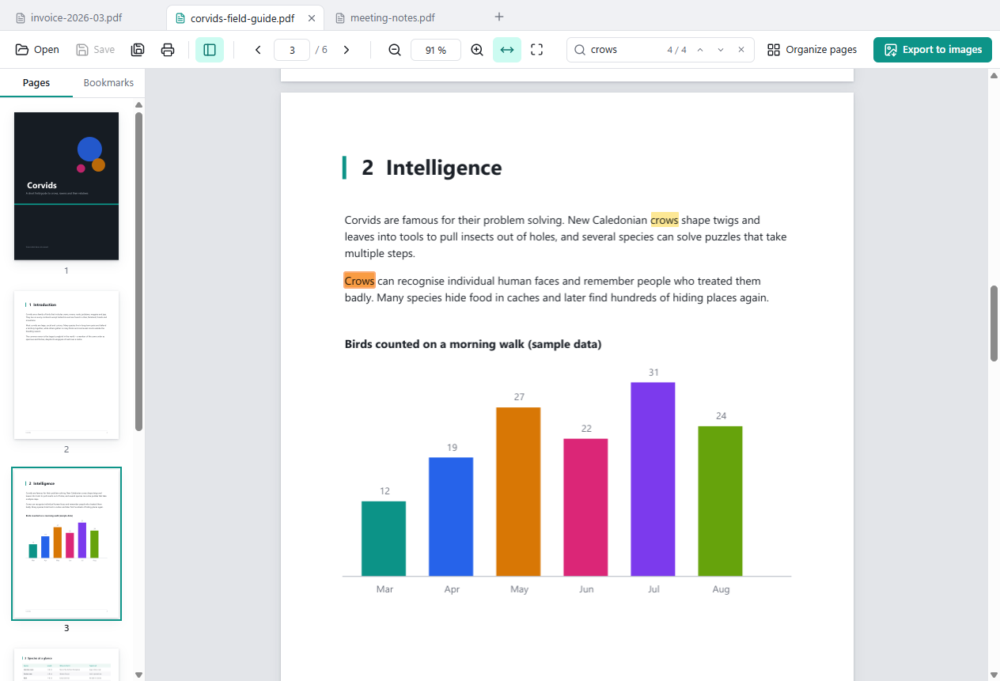

# Scamcrobat

**English** · [Čeština](README.cs.md)

[](https://github.com/Aleshek/Scamcrobat/actions/workflows/ci.yml)
[](https://github.com/Aleshek/Scamcrobat/releases/latest)

A free (AGPL-3.0) PDF viewer and page editor – no subscription, no account, no ads.
It runs as a Windows desktop app (it can be your default program for `.pdf` files)
and as a web page; both versions share the same code.

**[⬇ Download for Windows](https://github.com/Aleshek/Scamcrobat/releases/latest)** ·
**[Try it in your browser](https://aleshek.github.io/Scamcrobat/)**

<picture>
  <source media="(prefers-color-scheme: dark)" srcset="docs/viewer-dark.png">
  
</picture>

<picture>
  <source media="(prefers-color-scheme: dark)" srcset="docs/organizer-dark.png">
  
</picture>

## Download

**Windows:** the `Scamcrobat-Setup-….exe` installer is attached to the
[latest release](https://github.com/Aleshek/Scamcrobat/releases/latest).
It installs for the current user only (no administrator rights needed) and registers itself
as a program for `.pdf` files. Windows 11 does not let apps make themselves the default, so
after installing: right-click a PDF → Open with → Choose another app → Scamcrobat → Always.

The installer is not digitally signed yet, so Windows SmartScreen shows a warning the first
time it runs ("More info → Run anyway").

**Web:** the same app runs in the browser at <https://aleshek.github.io/Scamcrobat/>.
Your files are never uploaded – everything is processed right in your browser.

The app is available in **English** and **Czech**; it follows the system language and can be
switched on the start page.

## Features (version 0.3)

- open PDFs by double click, from the dialog (Ctrl+O) or by dropping them into the window
- **tabs** for several open documents (Ctrl+Tab to switch, Ctrl+W to close, Ctrl+T for a new tab);
  opening another PDF from Explorer adds a tab to the running window
- smooth scrolling through all pages, page thumbnails and bookmarks (document outline)
- zoom with buttons, Ctrl+wheel (around the cursor), fit width (Ctrl+2), fit page (Ctrl+0), 100 % (Ctrl+1)
- text search (Ctrl+F, Enter/F3 next result, Shift+F3 previous) – ignores case and accents
- text selection with the mouse (double click selects a word) and copying (Ctrl+C)
- **printing** (Ctrl+P) – all pages, the current one or a range; landscape pages stay landscape
- **export pages to JPG / PNG / WebP** (Ctrl+E) – DPI, quality, page range and web friendly file names
- **organizing pages** ("Organize pages"): rotate, delete, reorder by dragging, insert pages
  from another PDF (also by dropping a file right between the pages), undo/redo (Ctrl+Z / Ctrl+Y)
- **merging several PDFs into one** (on the start page or with "Insert PDF")
- **splitting a PDF** into single pages, chunks of N pages or ranges, and **extracting** selected pages
- Save (Ctrl+S) and Save as (Ctrl+Shift+S); bookmarks, metadata and forms of the original
  document are kept, and you are warned about unsaved changes when closing
- password protected documents
- light and dark theme following the system setting

## Development

You need [Node.js](https://nodejs.org/) 22+.

```bash
npm install
npm run dev          # web version at http://localhost:5173
npm run dev:app      # desktop version (Electron) with live reload
npm run app          # desktop version from a production build
```

If Electron was not downloaded during `npm install` (npm 12 blocks install scripts),
run `node node_modules/electron/install.js` once.

## Building

```bash
npm run build        # web version into dist/ (upload it to any static hosting)
npm run dist         # Windows installer into release/
```

### Releasing a new version

Installers are built by GitHub (`.github/workflows/release.yml`), not on a developer's machine:

1. bump `version` in `package.json` (and run `npm install --package-lock-only`), commit
2. `git tag -a v0.3.0 -m "Scamcrobat 0.3.0"` and `git push origin v0.3.0`
3. GitHub builds the installer on Windows and creates a Release with generated release notes

The web version is deployed to GitHub Pages automatically on every push to `main`
(`.github/workflows/pages.yml`; the repository settings need Pages → Source: GitHub Actions).

## Architecture

```
electron/        main process of the desktop app (window, dialogs, writing files)
  main.js        app:// protocol, single instance, files from the command line, printing
  preload.cjs    a narrow bridge between the window and the system (the window has no Node.js access)
src/
  engine/        PDF engine: MuPDF (WebAssembly) in a Web Worker + render queue
  viewer/        virtualized page view, zoom, text selection, highlights
  components/    toolbar, tabs, sidebar, dialogs
  export/        export to images
  print/         printing
  organize/      organizing pages, merging and splitting PDFs
  i18n/          translations (en.tsx is the source, other languages follow its shape)
  App.tsx        tabs, opening and saving documents
  DocView.tsx    one open document: toolbar, sidebar, viewer
  platform.ts    desktop vs. web differences (dialogs, saving files)
scripts/         dev server, icons, test and demo PDFs
```

PDFs are rendered by [MuPDF](https://mupdf.com/) from Artifex (AGPL-3.0) – the same engine
SumatraPDF uses. It runs in a Web Worker, so the interface never freezes, even with large
documents; only the pages that are visible get rendered. Every tab keeps its view (zoom,
scroll position, search), while hidden tabs release their rendered pages.

Page editing is non-destructive: the organizer only works with a list of "page X of file Y,
rotated by Z°" and the real PDF is built when you click Done. It starts from a fresh copy of
the original document, pages from other files are grafted into it and then everything is
rearranged – that is why bookmarks, metadata, links and forms survive. On the desktop, saving
goes through a temporary file, so an error (file open elsewhere, full disk) never damages the original.

Printing renders the chosen pages to images (150 or 300 DPI) and hands them to the system print
dialog, one image per sheet, each sheet sized like its PDF page – the same approach the PDF
viewers built into browsers use.

### Translations

All texts live in `src/i18n/` – `en.tsx` defines every message and `cs.tsx` implements the same
shape, so a missing translation is a compile error. A new language means a new file next to them
and an entry in `src/i18n/index.ts`; the few texts of native desktop dialogs are in
`electron/main.js`. The language can be forced with `?lang=en` in the URL or the `SCAMCROBAT_LANG`
environment variable.

### Automated desktop test

`SCAMCROBAT_SMOKE_SHOT=shot.png` makes the app save a screenshot of the window after loading and quit.
Optional: `SCAMCROBAT_SMOKE_SCRIPT=script.js` (run in the window first),
`SCAMCROBAT_SMOKE_THEME=light|dark`, `SCAMCROBAT_SMOKE_PRINT=out.pdf` (printing writes a PDF
instead of opening the print dialog). The images in `docs/` were made this way.

Python helper scripts (need `pip install pymupdf pillow`):

```bash
python scripts/make-icons.py      # icons from public/logo.svg and build/file-pdf.svg
python scripts/make-test-pdf.py   # test/fixtures/sample.pdf
python scripts/make-demo-pdf.py   # test/fixtures/demo-en.pdf and demo-cs.pdf (README screenshots)
python pdf2jpg.py PDF             # one-off conversion of a folder of PDFs to JPG from the command line
```

## Roadmap

| Feature | Effort |
|---|---|
| ~~Merging, splitting, deleting and rotating pages + saving PDFs~~ | done in 0.2 |
| ~~Printing, tabs for several documents, English~~ | done in 0.3 |
| Rotating the view, clickable links | small |
| Merging bookmarks of all merged PDFs | small |
| Images → PDF, PDF compression | medium |
| Annotations (highlights, notes) and filling in forms | larger |
| Inserting a signature image | medium |
| OCR of scanned documents | larger |
| Editing existing text | very large |

## License

[GNU AGPL-3.0 or later](LICENSE). MuPDF © Artifex Software, Inc., AGPL-3.0.

Scamcrobat is an independent project and has nothing to do with Adobe.
Adobe and Acrobat are trademarks of Adobe Inc.
